## About Me

**Data Analysis & AI** | Focused on turning data into useful, well-explained work.

**Machine Learning & NLP** | Interested in practical applications and clear results.

**Next focus** | Exploring Deep Learning & LLMs.

---

##  Technical Toolkit

###  Programming Languages

      

###  Libraries & Frameworks

      

###  Artificial Intelligence

  

###  Machine Learning & Modeling

     

###  Data Science & Analytics

     

###  Tools & Workflow

    

---

##  Featured Projects

| Project | What it does | Stack |
| --- | --- | --- |
| [Retail Intelligence Dashboard](https://github.com/osamanady-ai/retail-intelligence-dashboard) | UK online-retail analysis on 541k real transactions with an interactive Streamlit dashboard | pandas, Streamlit, Plotly, SQL |
| [Penguin Field Notes](https://github.com/osamanady-ai/penguin-field-notes) | Exploratory ecology data analysis with missing-data audits and species comparisons | pandas, Streamlit, Plotly |
| [Handwritten Digit Classifier](https://github.com/osamanady-ai/handwritten-digit-classifier) | Digit recognition with train-only model selection and error analysis | scikit-learn, NumPy |
| [Diabetes Progression Regression](https://github.com/osamanady-ai/diabetes-progression-regression) | Ridge regression benchmark with residual diagnostics | scikit-learn, pandas |
| [SMS Spam Detector](https://github.com/osamanady-ai/sms-spam-detector) | TF-IDF + logistic regression spam classifier with held-out metrics | scikit-learn, NLP |

 

---

##  Let's Connect

   

<i>Curiosity first. Clear thinking. Useful results.</i>

